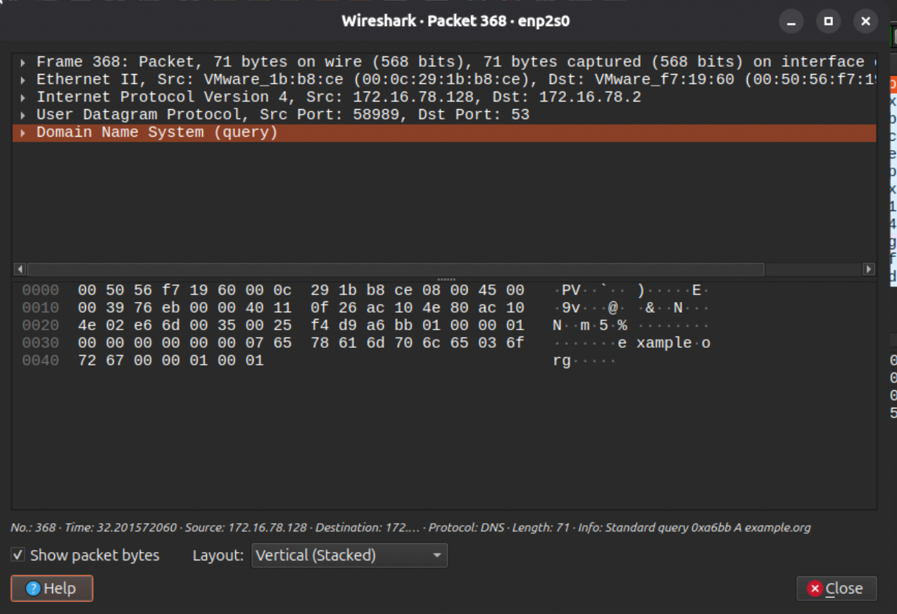
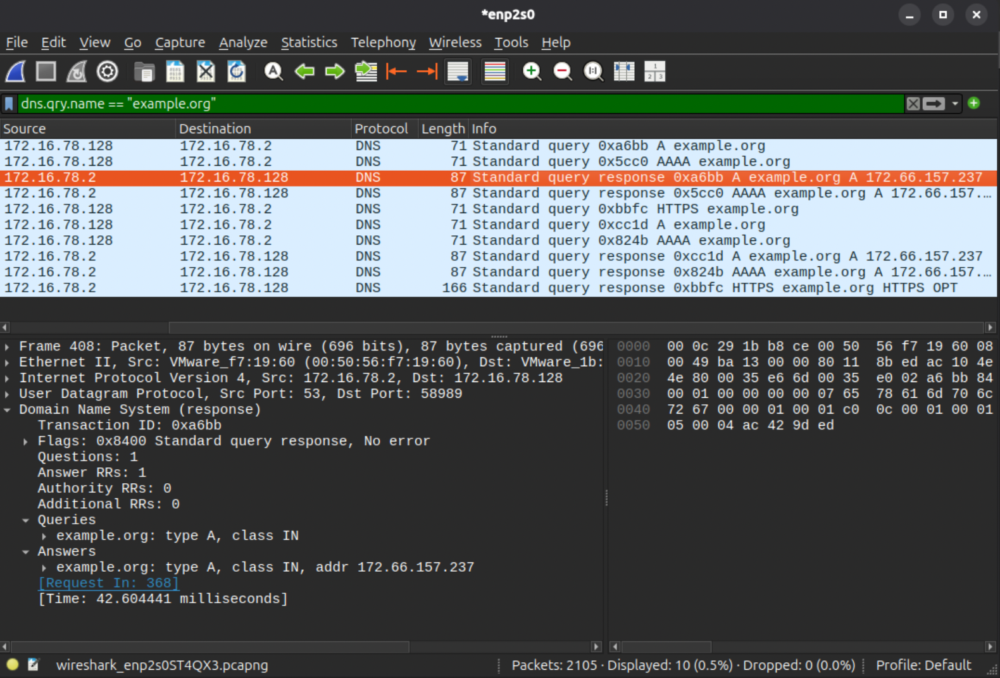
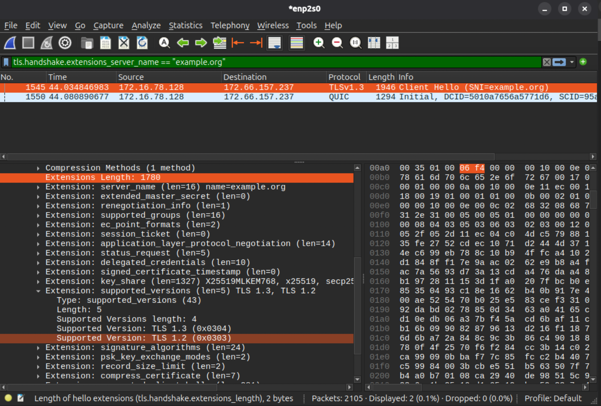
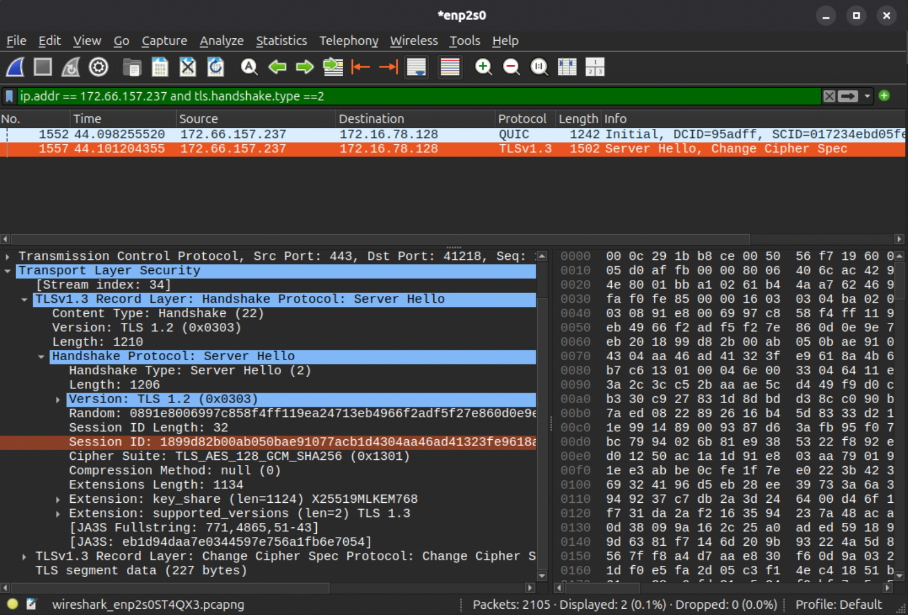

# Wireshark DNS and TLS Traffic Review

I captured a visit to `https://example.org` from my Ubuntu virtual machine and followed the connection from its DNS lookup to the TLS handshake.

## What I looked at

- DNS requests and responses for `example.org`
- The TLS Client Hello and Server Hello
- The server name, supported TLS versions, and selected cipher suite

## What I found

- The DNS A response for `example.org` returned `172.66.157.237`.
- The Client Hello named `example.org` and offered TLS 1.3 and TLS 1.2.
- The server replied with a TLS 1.3 Server Hello and selected `TLS_AES_128_GCM_SHA256`.
- Wireshark also showed QUIC traffic between the VM and the same server address.

## How I captured it

I captured traffic on the Ubuntu VM's `enp2s0` interface while visiting `https://example.org`. I used Wireshark display filters to focus on the DNS lookup and TLS handshake:

```text
dns.qry.name == "example.org"
```

```text
tls.handshake.extensions_server_name == "example.org"
```

```text
ip.addr == 172.66.157.237 and tls.handshake.type == 2
```

## Evidence

### DNS query



### DNS response



### TLS Client Hello



### TLS Server Hello



## Scope and limitations

This was a short capture of traffic from my own Ubuntu VM. The capture also contained unrelated background traffic, so I used filters to focus on the test connection. I reviewed the handshake but did not decrypt TLS application data. This exercise shows basic packet inspection; it does not represent an attack or a test against another system.
